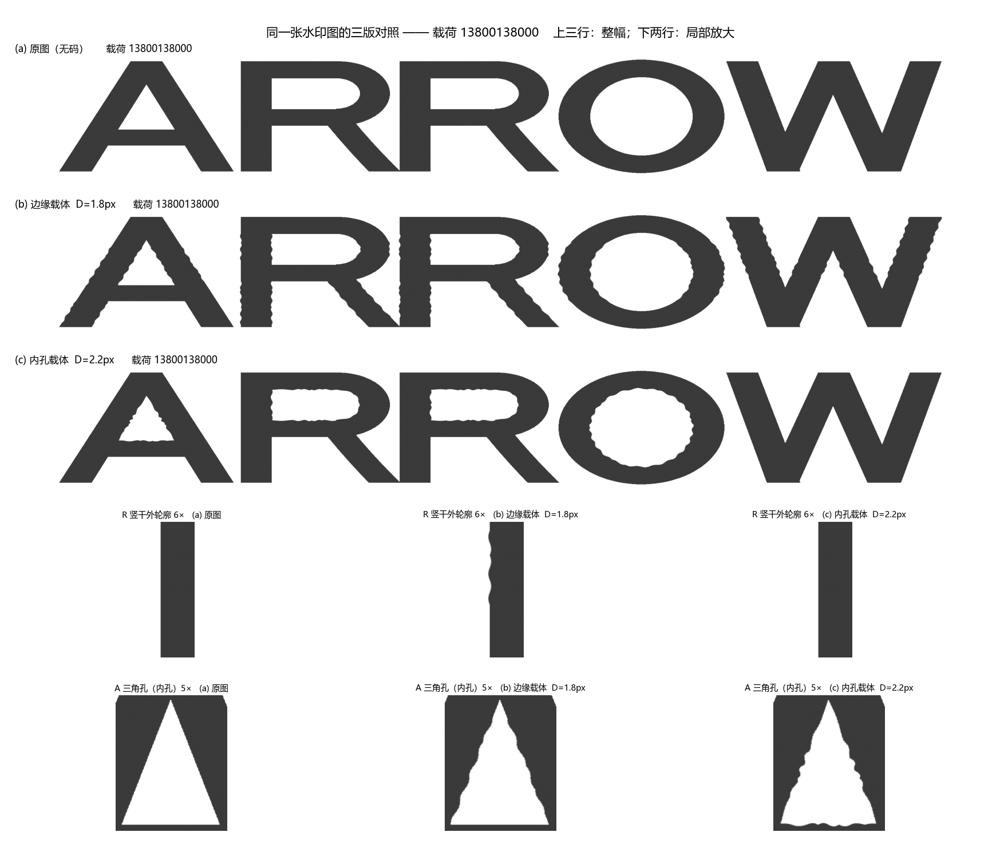
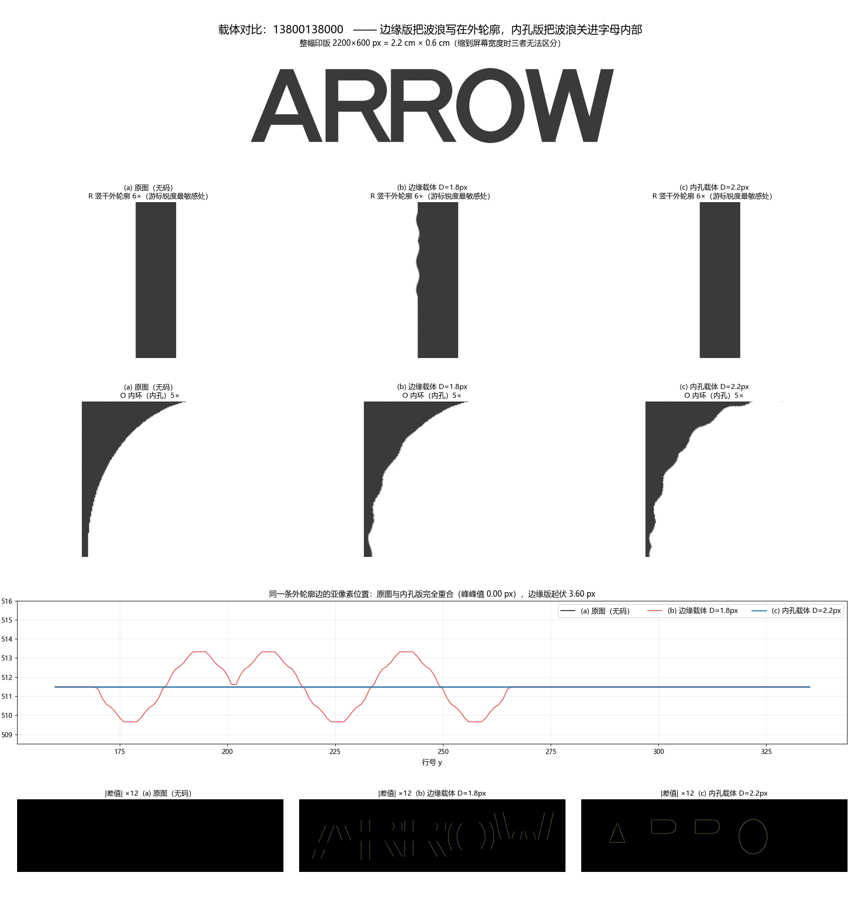

# ARROW 隐形水印 · Sub-pixel Geometric Watermark

> 把 11 位号码写进 Logo 笔画的**亚像素宽度**里，用手机拍照就能盲解。
> 信息不写在灰度上，写在几何尺寸上——所以打印、油墨扩散、曝光、反光都拿它没办法。



*第 1–3 行：原图 / 边缘载体 / 内孔载体（同一号码 `13800138000`）。第 4–5 行：笔画边缘与内孔的 6× 放大。*

---

## 一句话原理

把号码编码成 70 bit，再用**相邻两个码元一宽一窄**的方式，写进笔画边缘的亚像素位移里。
解码时靠字母自身的几何形状把照片掰正，逐行量出亚像素宽度差，再解回号码。

整个方案**没有任何定位标记**——图上只有 ARROW 五个字母。

## 巧在哪

**① 写在几何上，不写在灰度上。**
打印-拍摄链路里灰度会被油墨扩散、曝光、白平衡、釉面反光彻底改变；但"这条笔画有多宽"相对稳定。这决定了方案能否在实物上活下来。

**② 写在"宽度"上，不写在"位置"上。**
位置需要绝对参考系，一拍歪就全废；宽度是**局部差分**，不需要参考系。这是能盲解的根本原因。

**③ 差分对抵消一切慢变量。**
相邻码元一加宽一收窄，解码时相减。油墨整体扩散、光照梯度、笔画本身的粗细漂移都是共模的，相减就没了。边缘与内孔的默认调制幅度都是 **±6.0 px**（约 ±0.060 mm）。笔画宽约 71 px 时，相邻码元的宽度差是 12 px。外轮廓上这道波比早期的 ±1.8 px 更明显；要外轮廓和设计稿逐像素一致，用内孔载体。

**④ 50% 交叉点对模糊免疫。**
高斯模糊是对称的：边缘过渡变宽，但 50% 高度处的横坐标**完全不动**。所以用半高宽而不是"第一个暗像素"，失焦几乎不影响测量。

**⑤ 嵌入与检测共用同一基函数。**
嵌入是 `d·sin(πt)`，解码就用同一个 `sin(πt)` 做投影——匹配滤波，加性噪声下是最大似然最优。正弦窗两端为零，相邻码元无缝衔接。

**⑥ 几何基准来自字形自身。**
五字母质心 / 凸包四角 / 二阶矩仿射 / 墨迹包围盒 / 内孔质心 / SIFT 特征点，六类候选一起用 NCC 打分择优，再由 ECC 亚像素精配收尾。

## 参数

| 项目 | 值 |
|---|---|
| 载体 | 白底深灰字单色「ARROW」无衬线粗体，2200 × 600 px（= 2.2 cm × 0.6 cm，1000 px/cm 制版） |
| 载荷 | 任意 11 位十进制数字（≤ 2³⁷，37 bit） |
| 纠错 | Hamming(7,4)，37 → 70 bit |
| 调制 | 差分宽度调制，140 码元 / 70 差分对；边缘与内孔默认都是 **±6.0 px（±0.060 mm）** |
| 解码 | SIFT+RANSAC 定位 → 单应矫正 → ECC 精配 → 匹配滤波半高宽 → 软判决最大似然 |
| 依赖 | numpy / opencv-python / matplotlib / pillow |

## 实测性能

仿真器模拟陶瓷拍摄链路（透视 + 离焦 + 光照不均 + 釉面高光 + 噪点 + JPEG），**50 组随机号码 × 5 档扰动**：

| 扰动档位 | 内孔载体（6.0 px） | 边缘载体（旧工作点 ±1.8 px，仅作历史对照） |
|---|---|---|
| 无扰动 | **100%** · 0.00% | 100% · 0.00% |
| 轻度 | **100%** · 0.00% | 100% · 0.06% |
| 中度 | **100%** · 0.00% | 100% · 0.26% |
| 重度 | **98%** · 0.20% | 100% · 1.06% |
| 极限 | **60%** · 6.00% | 74% · 7.49% |

*每格为「研究解码器完整号码正确率 · 纠错前误码率」，各 50 样本，**不经过**现在的生产门。边缘列是 `MOD_DEPTH = 1.8` 时的已发表数字。当前边缘默认是 ±6.0 px，并且码元避开了净空贴门限和陡斜段；现行压测请看 `python arrow_wm.py --bench`，表里单列「接受且错」。*

- 单次嵌入约 35–60 ms，单次盲解码 0.5–2.5 s（视是否触发粗搜抢救）
- 打印分辨率不是瓶颈：等效 635 dpi 与 2540 dpi 的结果完全相同（调制是 18 px 周期的平滑正弦）
- 极限档的失败经真值单应对照确认：约一半是配准、一半是信号不足

## 快速开始

```bash
pip install -r requirements.txt
```

`requirements.txt` 使用 `opencv-python-headless`（CI 与服务器无图形界面时用这个）。本机若已装带 GUI 的 `opencv-python`，不必再装 headless，二者都提供 `cv2`。

**生成印版**

```bash
# 单张，内孔载体（默认），输出到当前目录
python gen_plate.py 13800138000

# 旧边缘印版：显式 --carrier edge
python gen_plate.py 13800138000 --carrier edge -o out.png

# 批量，两版都出，附带 1bit 二值版
python gen_plate.py 13800138000 13912345678 18600001234 --carrier both -d out --1bit

# 号码写在文本文件里（每行一个，# 开头为注释）。默认内孔；旧边缘印版加 --carrier edge
python gen_plate.py --file numbers.txt -d out
```

生成后会自动解一遍并打印 OK / FAIL，不用再单独验。

**解码照片**

```bash
# 内孔载体（生产默认；可一次给多张）
python batch_decode.py photo1.jpg photo2.jpg

# 旧边缘印版
python arrow_wm.py --decode photo1.jpg photo2.jpg

# 内孔研究入口
python arrow_inner.py --decode photo1.jpg

# 单张边缘核验图（旧边缘印版）
python verify_decode.py photo.jpg --digits 13800138000

# 批量扫目录，出表格 + CSV（默认内孔；旧边缘印版加 --carrier edge）
python batch_decode.py photos/ --csv result.csv --save-figs
```

**库接口（生产解码）**

命令行和 `from arrow_decode import decode` 走同一道门。默认载体是**内孔**；旧边缘印版要显式 `carrier="edge"` 或 `--carrier edge`。边缘实现仍在，本接口不改它的算法。

```python
from arrow_decode import decode

result = decode(image)                    # carrier="inner"
# result = decode(image, carrier="edge")  # 旧边缘印版
# result = decode("photo.jpg")            # 路径也可以

if result.accepted:
    phone = result.digits                 # 仅此时是可信号码
    # result.margin / result.cc / result.logo_scale / result.mean_conf
else:
    phone = None                          # result.digits 一定是 None
    # result.candidate_digits 是研究解码器的原始读数，不可当号码使用
    # result.reason：low_margin / low_cc / invalid_payload / sync_failed / ...
```

成功只看 `result.accepted is True`（HTTP 里等价于 `status === "accepted"`）。`ok` 只表示研究解码器跑完了同步，无码图也常常是 `true`。`candidate_digits` 是原始读数，不能当号码。

接受条件（同时满足，外加码字本身是 11 位合法号码）：

| 门 | 默认 | 依据 |
|---|---|---|
| 裕度均值 `margin` / `margin_mean` | ≥ 1.8 | 有码/无码门。作用在按期望幅度归一化后的 soft_n 上，再除以标准差，不是像素门，也不是旧的 1.8 px 深度。真码均值 ≥ 2.0，噪声/无码 ≤ 1.4。单组选错会被其余组抬高 |
| 单组最小 `margin_min` | ≥ 0.55 | 十组里最弱的一组。均值高但这一组接近打平时拒绝。真机内孔照最弱组约 0.60 仍接受；近乎打平的冒烟样本约 0.33 仍拒绝 |
| 第 0 组补零 | 必须是 `000` | 编码时 37 bit 前补了 3 个 0。读出来不是 `000` 则 `reason=pad_mismatch` |
| 配准 `cc` | ≥ 0.85 | 与解码器内部「这条路径能不能信」的门相同；低于此值时置信度可能虚高 |
| 画面尺度 `logo_scale` | ≥ 0.15 | Logo 在照片里的宽度 / 2200。低于此值 `reason=low_logo_scale`。文档里的 0.077 小图仍拒绝。±6 px 在 0.08 倍尺度上只有约 ±0.5 个相机像素 |

任一不过：`accepted=False`，`status="rejected"`，`digits=None`。批量 CSV 的「号码」列同样留空；核验图标题写「拒绝（结果不可信）」，不把候选号画成解码结果。

`margin` / `margin_min` 是 soft_n 的组间 z 分数。全局乘一个正的深度常数不会搬动这两个数，所以深度从 1.8 改到 6 之后仍用 1.8 和 1.0，而不是把旧的像素语义套过来。自信地选错一整组时，这一组的间隙仍然可以大于 1.0，本门挡不住，那要改码字格式加 CRC，这次不做。重标定：`python arrow_wm.py --bench -n 20 --dump-pairs pairs.csv`，看「接受且错」列。

研究压测现在先解码、再过同一道生产门，报告里分开「接受且对 / 接受且错 / 拒绝」。`arrow_wm.py --no-ecc`（库接口 `use_ecc_refine=False`）不算配准分，`cc` 保持 0，这时只跳过 cc 门，裕度门、补零和其他接受条件仍在。默认 ECC 开着。

本地自检（也是 CI 在跑的那条）：

```bash
python ci_smoke.py
```

**验真模式**（照片糊到盲解失败、但你知道嫌疑号码时）

```bash
python verify_decode.py photo.jpg --suspect 13800138000
```

不做纠错。输出目标号码的绝对相关 z，以及它和**改一位**的最近邻号之间的间隙。强证据要同时满足 z ≥ 4.5 且间隙 ≥ 0.45。只看绝对 z 不够：理想软信息下，最近的一位邻号码距是 3，绝对 z 仍可以高于 4.5，但间隙是负的。

**压测**

```bash
python arrow_wm.py --bench -n 50 --seed 20261101 --layout 2 --depth 6 --dump-pairs pairs.csv
python arrow_wm.py --ablation -n 16 --seed 20261101
python arrow_wm.py --decode photo.jpg --layout 1          # 旧印版
python arrow_wm.py --decode photo.jpg --layout auto       # 先 v2，再 v1@1.8
```

## 两种载体

| | 边缘载体 `arrow_wm.py` | 内孔载体 `arrow_inner.py` |
|---|---|---|
| 调制位置 | 外轮廓 | 字母内部的孔（O 内环、两个 R 字怀、A 上三角） |
| 调制深度 | **±6.0 px（±0.060 mm）** | **±6.0 px（±0.060 mm）** |
| 外轮廓 | 有细微波浪 | **逐像素与原图相同** |
| 重度 / 极限 | 见下一节消融（默认 v2@6） | **98% / 60%**（历史研究解码器） |
| 适用 | 要求最高解码率 | 客户质检要求"外轮廓和设计稿一模一样" |



*第 4 行是 R 竖干左边缘的亚像素位置随行号变化。仓库里这张图是早期 ±1.8 px 工作点画的（峰峰约 3.66 px）。当前边缘默认是布局 v2、±6.0 px，峰峰约 12 px。旧印版用 `--layout 1`（冻结在当时的码元位置和 ±1.8 px）。*

## 边缘布局 v1 / v2

默认是布局 **v2**、`MOD_DEPTH = 6`。v1 保留，不删。

| | v1 | v2（默认） |
|---|---|---|
| 码元位置 | 冻结。几何 sha1 `ed2c4135922d67afd4f507f052ddfc2f7e3f895f`（含 d=1.8 的测量窗） | 同区段相邻配对，140 格，高度 ≥ 14，净空 ≥ 24，笔画宽 ≥ 24 |
| 深度 | 不写 `--depth` 时是 1.8。`--layout 1 --depth 6` 只加深度，不挪格子 | 6.0。净空 `max(20, ceil(2d+10+2))` |
| 比特到格子 | 恒等 `PAIR_PERM` | 冻结置换 `v2-snake-r1`：每组尽量 7 条轨迹、至少 4 个字母。只置换这一次 |
| 命令 | `--layout 1` | `--layout 2`（默认）。解码还可以 `--layout auto`（先 v2，不接受再试 v1@1.8） |

软判决和裕度门用 `soft_n = 实测差分 / (π·depth·scale)`。满调制在 sin 窗下大约是 ±1。`WINDOW_POW=2` 的期望幅度公式仍按 sin 写，所以 pow2 的 `|soft_n|` 不能和 pow1 直接比高低。

嵌入、压测：

```bash
python gen_plate.py 13800138000 --layout 2 --depth 6
python arrow_wm.py --bench -n 16 --seed 20261101 --layout 2 --depth 6 --dump-pairs pairs.csv
```

`--dump-pairs` 每比特一行：种子、档位、号码、布局、深度、配准是否合格、配准残差、几何对、轨迹、字母、高度、斜率、净空、端距、是否跨区段、soft、soft_n、比特错、组间隙。

### 消融（seed 20261101，每档 N=16）

生产门「接受且号码正确」。研究解码器整号正确率写在括号里。BER 是纠错前硬比特。误接受是「接受且错号」。

| 配置 | 轻 | 中 | 重 | 极限 BER | 极限研究正确 | 极限接受且对 | 极限配准合格子集 | 误接受 |
|---|---|---|---|---|---|---|---|---|
| v1@1.8 | 16/16 | 16/16 | 15/16（研究 16/16） | 6.61% | 9/16 | 6/16 | 9/15 | 0 |
| v1@6 | 16/16 | 16/16 | 16/16 | 0.00% | 16/16 | 16/16 | 16/16 | 0 |
| v2@6 | 16/16 | 16/16 | 16/16 | 2.23% | 15/16 | 15/16 | 15/15 | 0 |
| v2@6+pow2 | 16/16 | 16/16 | 16/16 | 0.09% | 16/16 | 16/16 | 16/16 | 0 |

同一批号码把极限档加到 **N=64**（只跑了默认 v2@6）：BER **3.73%**，研究正确 **59/64（92%）**，接受且对 **57/64（89%）**，配准合格 58/64，合格子集里号码正确 **57/58（98%）**，接受且错 **0**。N=16 的四组配置加上这 64 次，去掉重复的 16 次，生产门一共看了 **368** 次，接受且错号 **0**。方案里的累计 ≥1500 次没有跑满。

N=16 时轻/中/重在 v2@6 上是 16/16。极限研究正确率 92%（N=64）过了 85% 这档的方向；BER 3.73% 高于 2.5% 的目标。pow2 在 N=16 的极限上更好（BER 0.09%），默认窗仍是 sin。没有做 5 人目视，也没有把默认改成 pow2。

v1@6 和 v1@1.8 的极限配准残差（ECC 角点位移，px）P50/P95：20.5/31.0 与 18.5/40.8。深度提到 6 没有把配准残差抬一个量级。

零退化 1000 个干净载荷的 μ_p 扫描没有跑。N=16 里配准合格样本的 soft_n 中位：v1@1.8 为 0.86（最差对 0.54），v2@6 为 0.86（最差对 0.73）。v1@1.8 的最差对低于 0.8。

### 实拍失败：17701234567

398×398 的纸面照片。ARROW 在画面下方，约占 177×96 px，底下印着可见的号码标签。纸面上有一道竖向折痕。真值是 **17701234567**。同一号码的干净印版在这个解码器上是接受的（v2 裕度均值 5.81，最小 5.44，`|soft_n|` 均值 0.99，验真 z=8.35）。

| 读法 | logo_scale | mean_conf | \|soft_n\| | 裕度均值 / 最小 | 相对真值 BER | 验真 z | 结果 |
|---|---|---|---|---|---|---|---|
| 原图 v2@6 | 0.077 | 0.012 | 0.09 | 0.81 / 0.03 | 0.60 | −0.25 | 拒绝。候选不是合法号码。cc=0.97 |
| 原图 v1@1.8 | 0.077 | 0.010 | 0.24 | 1.13 / 0.32 | 0.46 | 0.51 | 拒绝。候选 62858359082，不是真值 |
| 原图 v1@6 | 0.077 | 0.012 | 0.09 | 1.43 / 0.20 | 0.50 | 0.81 | 拒绝。候选仍不是真值 |
| 裁出 Logo 再 4×，v2@6 | 0.314 | 0.012 | 0.09 | 1.00 / 0.40 | 0.54 | −0.12 | 仍然拒绝 |
| 同上，v1@1.8 | 0.314 | 0.011 | 0.27 | 1.34 / 0.31 | 0.53 | 0.68 | 仍然拒绝 |

按测量排：

1. 原图 `logo_scale=0.077`，低于现行门 0.15（改门前是 0.20）。配准没有失败（cc=0.97）。±6 px 乘这个尺度约 ±0.46 个相机像素，±1.8 px 约 ±0.14 个像素，两种深度都采不到波形。生产门因此多一个 `low_logo_scale`，号码仍然是 `None`。
2. 把同一张图放大到尺度 0.31 之后，`mean_conf` 仍是 0.012（干净印版是 0.128），相对真值的 BER 仍在 0.5 附近，补零也不是 `000`。放大没有多出光学采样。Logo 带上方纸面的竖向亮度起伏大约 2 个灰度级，折痕看得到，但解释不了这档误码；测不到的是差分宽度本身。
3. 换成冻结的 v1@1.8 或 v1@6，验真 z 仍小于 1（干净印版是 8.3），间隙是负的，判定「不包含」。不是门限差一点点，也不是新布局把旧印版解错了。裕度门没有为这张图放宽。

## 目录

```
arrow_wm.py            边缘载体核心（嵌入 / 解码 / 仿真 / 压测）
arrow_inner.py         内孔载体核心
arrow_decode.py        生产解码 API（内孔默认，边缘可选，裕度 + cc 硬门）
gen_plate.py           生成印版（单张 / 批量 / 两种载体）
verify_decode.py       单张解码 + 核验图 + 验真模式
batch_decode.py        批量解码（扫目录 / CSV / 批量出图）
ci_smoke.py            嵌入/解码冒烟 + 接受门单测（CI 入口）
requirements.txt       运行与 CI 依赖
Dockerfile             仓库根构建上下文（与 services/decode_api/Dockerfile 相同）
wxcloudrun/             微信云托管把目标目录设为该文件夹时的构建上下文
docs/wechat-cloudrun.md 微信云托管控制台清单与 callContainer 示例
.github/workflows/ci.yml  安装依赖并跑 ci_smoke.py
make_test_samples.py   生成 10 组随机号码实测样张 + A4 打印排版图
compare_carrier.py     两种载体的定量对比
compare_same_payload.py 同一号码的三版对照图
sample_gallery.py      样张总览图
export_print_plates.py 批量导出送印图
ablation_interior.py   内孔载体消融实验
ARROW_clean_pro.png    字形母版（必需，不能删）
docs/技术报告.md        完整技术报告（原理、实验、踩坑记录）
samples/               样张与插图
```

## 已知局限

- **容量由边缘长度决定**，不是面积。2200 px 宽的 Logo 有效边缘约 2000 px，70 bit 就是每 bit 28 px。想多写只能加大调制幅度（视觉更明显）或换更大的载体。
- **极限档 60%**（内孔载体；边缘载体能到 74%，但外轮廓会留下波纹）是当前信噪比的边界。其中约一半失败来自配准、一半来自信号不足；后者受限于调制幅度，再加就破坏隐蔽性。
- **拍摄建议**：距离 8–15 cm，让 Logo 占画面 1/3 以上，避开强反光（最主要的干扰源）。倾斜 30° 以内能自动矫正。`logo_scale` 低于 0.15 时生产门直接拒绝（`low_logo_scale`）。把小图在手机上放大再送进来不会补上没拍到的边缘波形。纸面折痕要躲开笔画。
- **研究解码器对无码图仍会吐出一个号码**——判决器总要给出 0/1。生产入口 `arrow_decode.decode` 会拒掉它：裕度均值低于 1.8，或最弱一组低于 0.55，或第 0 组补零不是 `000`，或配准 cc 低于 0.85，或 `logo_scale` 低于 0.15，或码字不是合法 11 位号码时，`accepted=False`、`status="rejected"`、`digits=None`。不要用 `ok` 或 `mean|conf|` 判断成功。HTTP 默认不返回 `candidate_digits`。

## 理论出处

没有一篇"本方案出自某某论文"——这是一套针对具体场景拼出来的工程组合。各部分的理论源头：

- 用字形**几何变形**承载信息：Brassil, Low, Maxemchuk, O'Gorman, *Electronic marking and identification techniques to discourage document copying*, IEEE JSAC 1995
- 几何同步是打印-拍摄水印的核心难题：O'Ruanaidh & Pun, ICIP 1997；Kutter, SPIE 1998
- SIFT：Lowe, *Distinctive image features from scale-invariant keypoints*, IJCV 2004
- 扩频水印（对照，本方案**不走**这条路）：Cox et al., IEEE TIP 1997

自行设计并实现的部分：差分对 + 正弦窗 + 亚像素半宽的调制与检测组合、140 码元布局从字形掩膜自动推导、六类自同步候选池 + NCC 择优、内孔载体、软判决 ML 替代硬判决 Hamming。

## License

未附开源许可，保留所有权利。商业使用请联系作者。
